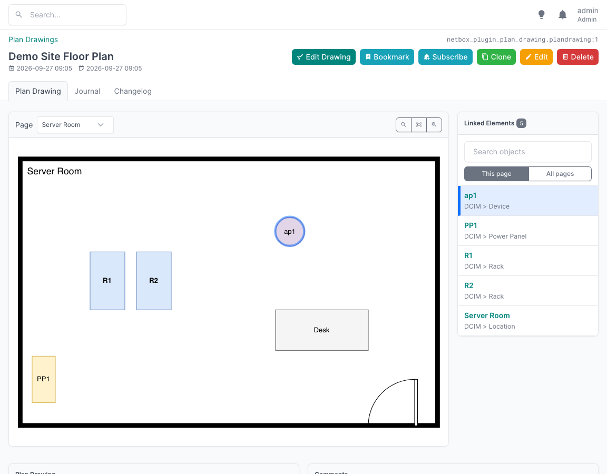
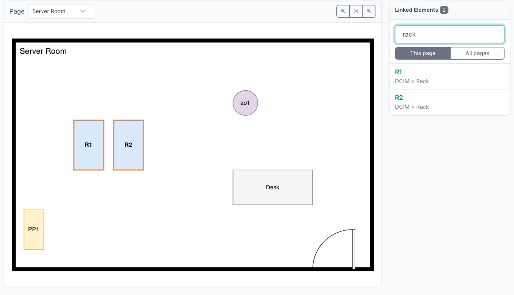
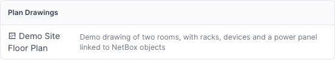
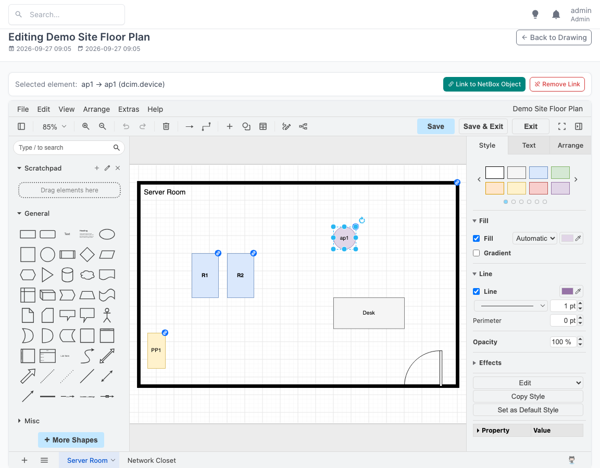
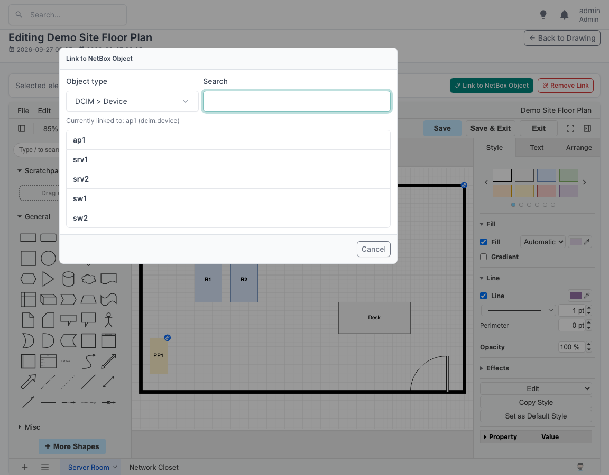

# NetBox Plan Drawing Plugin

This [NetBox](https://netbox.dev/) plugin adds plan drawings, like floor plans, to NetBox. You place devices, racks, locations, and other objects on the plans, and link each drawing element to its NetBox object. You can then go from a drawing to the objects in it, and from an object to where it is on a plan.

Drawings are created and edited with [draw.io](https://www.drawio.com/), which is included in the plugin: there is no separate service to install, and nothing is sent to draw.io's online services.

## Viewing drawings

The drawing page shows the drawing next to the list of **Linked Elements**: the elements linked to NetBox objects.

* Clicking an element in the drawing selects it in the list; clicking an entry in the list highlights the element in the drawing. Hovering over an entry highlights its element as well. The names in the list link to the NetBox objects.
* A selected **location** or **rack** shows the objects in it as a tree: a location contains its child locations, racks, devices not mounted in a rack, and power panels; a rack contains its devices, top to bottom; and a device contains the devices in its device bays. The names link to the objects. Objects that are linked in the drawing as well are marked with a link icon; clicking them highlights their elements in the drawing.
* Drawings can have several **pages**, e.g. one per room or floor. The list shows the elements of the page shown (**This page**), or of **All pages**.
* The **search** box filters the list by object name, element label, or object type, and highlights all matching elements in the drawing:

    

* The **zoom** buttons zoom in and out, and fit the drawing into the view; drag the drawing to move it around.

## Finding objects on plans

Every object that can be placed on a plan has a **Plan Drawings** panel on its page, listing the drawings it appears in. Clicking a drawing opens it with the object's elements highlighted, as in the screenshot above. Site and location pages also list the drawings assigned to them.

Drawings are also included in NetBox's global search.

## Editing drawings

**Edit Drawing** opens the drawing in draw.io, embedded in the NetBox page. All of draw.io's shapes and tools are available, including the floor plan shapes (under **More Shapes**).

To link an element to a NetBox object, select the element, and click **Link to NetBox Object** above the editor, or choose **Link to NetBox Object...** from the element's context menu. Choose the type of object, and search for it:

Linked elements are marked with a link badge in the editor; clicking the badge changes the link. The bar above the editor shows the link of the selected element; **Remove Link** removes it.

**Save** stores the drawing in NetBox, **Save & Exit** also returns to the drawing page. If someone else has saved the drawing since you opened it, saving is refused, so that their changes are not overwritten.

A drawing's name, site, location, description, and comments are edited with NetBox's usual **Edit** button.

## What can be linked

Elements can be linked to NetBox objects that represent physical things:

* sites and locations
* racks, devices, modules, virtual chassis, and inventory items
* device components: interfaces, console, power, front and rear ports, power outlets, device and module bays
* cables
* power panels and power feeds, and cooling equipment
* circuits and circuit terminations, provider networks
* wireless links

Types, templates, roles, and other organizational objects cannot be linked. The list can be changed in the [plugin configuration](installation.md#configuration).

## Permissions

Viewing drawings requires the *view* permission on Plan Drawings, editing them the *change* permission. The objects that elements are linked to are shown by name only to users who may view them.
